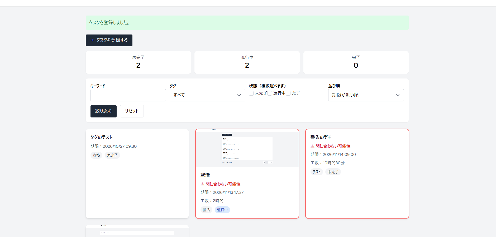
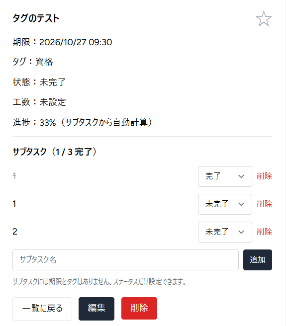
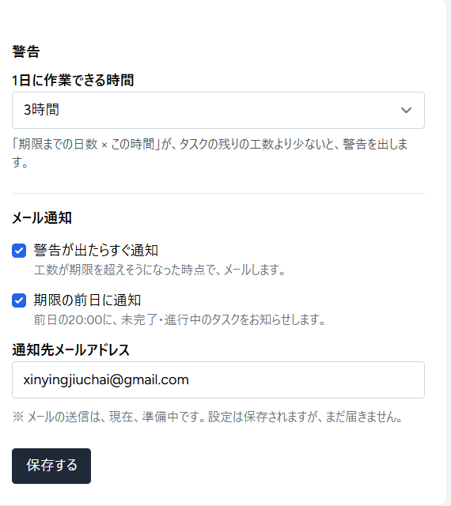
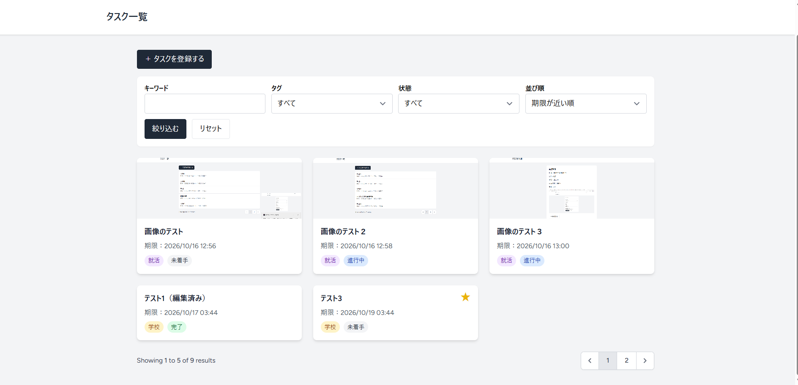
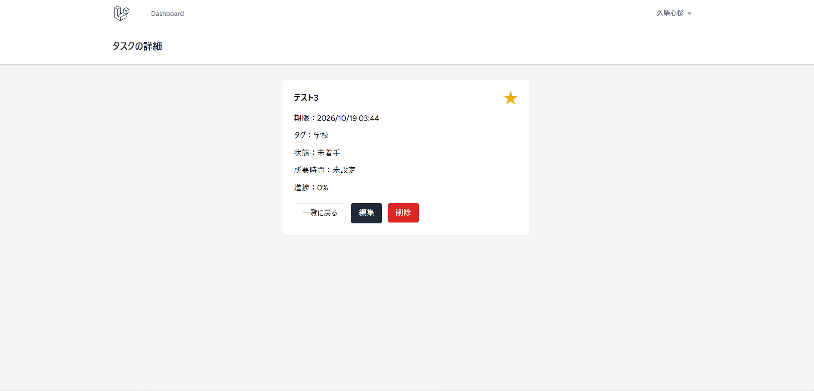
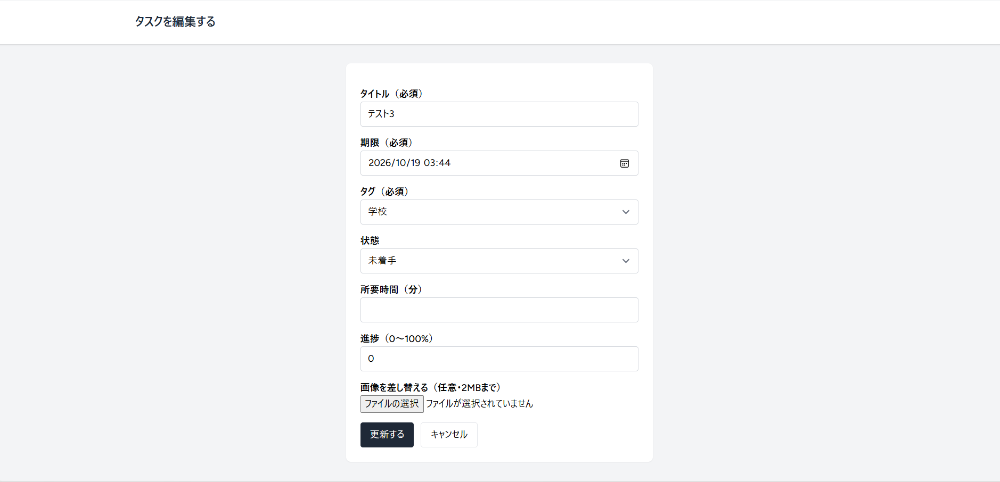
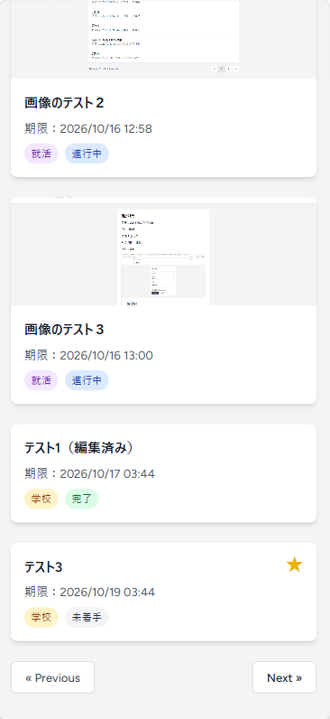
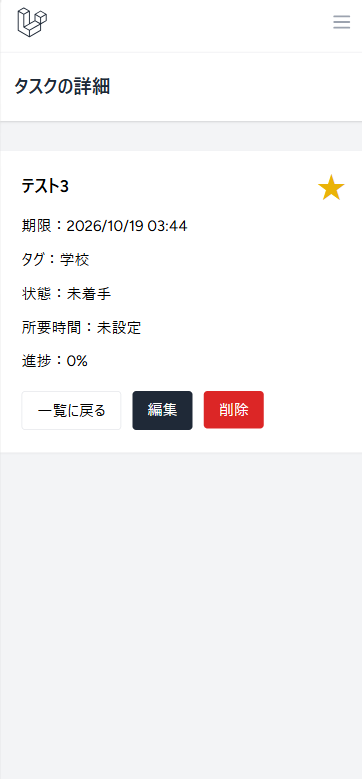

# MyFlow

大学生が、締め切りの重なる就活・課題の優先順位を一目で把握し、迷わなくなるタスク管理アプリ。

**公開URL：https://myflow-payf.onrender.com**

※ 無料プランのため、しばらくアクセスがないと停止します。最初の表示に1分ほどかかることがあります。また、再起動のたびに、登録したデータ（ユーザー・タスク・画像）が消えます。

## 背景

既存のTodoアプリでは、時間を自分で入力する必要があり、入力ミスで優先度を見誤ることがある。また、優先順位がひと目でわからないため、課題提出のギリギリまで手をつけられないことが多い。

## ターゲットユーザー

アルバイトを掛け持ちしながら、大学の課題・ゼミ・就職活動を両立している大学3〜4年生。

## 技術スタック

| 項目 | 内容 |
|---|---|
| バックエンド | PHP / Laravel 13 |
| 認証 | Laravel Breeze（Blade + Alpine.js） |
| スタイル | Tailwind CSS（Viteでビルド） |
| データベース | SQLite |
| メール | Laravel Mail（Gmail SMTP。動作確認は、ログへの書き出しと、テストメールの送信） |
| テスト | Pest（導入のみ。テストはまだ書いていない） |
| 公開 | Render（Docker） |
| 設計・管理 | Figma、GitHub Projects・Issues |

## 機能

- 認証（登録・ログイン・ログアウト）
- タスクの登録・一覧・詳細・編集・削除（`TaskPolicy`で、自分のタスクだけ操作できる）
- 期限・工数（30分単位）・タグ・状態・画像の登録
- タグを自分で作れる（共通のタグ＋自分のタグ。他のユーザーのタグは見えない）
- サブタスク（「n / m 完了」を表示。完了数から、親タスクの進捗を自動で計算）
- 検索・絞り込み（キーワード、タグ、状態は複数選択）と、並び替え（期限・工数）
- タスク数の表示（未完了・進行中・完了）
- 警告（「期限までの日数 × 1日の作業時間」が「残りの工数」より少ないと、赤く表示）
- 設定（1日の作業時間、通知のオン・オフ、通知先）
- 重要マーク（Ajax / Alpine.js）
- ページネーション、レスポンシブ対応
- メール通知（期限の前日の20:00、警告が出たらすぐ。同じタスクの警告は1回だけ）

## スクリーンショット

### Week24（PC）

| 一覧 | 詳細（サブタスク） | 設定 |
|---|---|---|
|  |  |  |

### Week23（PC）

| 一覧 | 詳細 | 編集 |
|---|---|---|
|  |  |  |

### Week23（スマホ）

| 一覧 | 詳細 |
|---|---|
|  |  |

## セットアップ（ローカル）

`src/` にLaravelのアプリが入っている。PHP、Composer、Node.jsが必要。

```
cd src
composer install
npm install
cp .env.example .env
php artisan key:generate
touch database/database.sqlite
php artisan migrate --seed
php artisan storage:link
npm run build
php artisan serve
```

`http://127.0.0.1:8000` で開く。

## Dockerで動かす

リポジトリ直下の `Dockerfile` と `docker-start.sh` を使う。起動のたびに、テーブルの作成と、初期データ（タグ・状態）の登録を行う。

```
docker build -t myflow-app .
docker run -p 10000:10000 -e APP_ENV=production -e APP_KEY=（php artisan key:generate --show で作った値） -e MAIL_MAILER=log myflow-app
```

## 公開（Render）

- RenderのWeb Serviceを、Dockerで作成（無料プラン）
- 環境変数：`APP_KEY`、`APP_ENV=production`、`APP_DEBUG=false`、`MAIL_MAILER=log`、`LOG_CHANNEL=stderr`、`APP_URL`
- データはコンテナ内のSQLiteなので、再起動で消える

## 通知について

- 「期限の前日」は毎日20:00、「警告が出たらすぐ」は10分ごとに、Laravelのスケジューラで動く（ローカルでは `php artisan schedule:work`）
- メール通知は、**ローカルで動作確認した**（ログへの書き出しで動作を確認。Gmailから、テストメールの送信も確認）
- **公開先（Renderの無料プラン）では、通知は動かない**。メール送信用の通信が制限され、アクセスがないと停止するため。設定画面の「準備中」の表示は、そのため残している

## 設計資料

| 種類 | リンク |
|---|---|
| 要件定義書 | [docs/requirements.md](docs/requirements.md) |
| DB設計書 | [docs/db-design.md](docs/db-design.md) |
| API仕様書 | [docs/api-spec.md](docs/api-spec.md) |
| 画面設計 | [docs/screen-design.md](docs/screen-design.md) |
| スプリント計画 | [docs/sprint-plan.md](docs/sprint-plan.md) |
| カンバン設計 | [docs/kanban-board.md](docs/kanban-board.md) |
| 工数見積もり | [docs/estimate.md](docs/estimate.md) |
| 見積書 | [docs/quotation.md](docs/quotation.md) |
| 技術選定資料 | [docs/tech-stack.md](docs/tech-stack.md) |
| 開発ボード | [MyFlow開発ボード](https://github.com/users/shio-0415/projects/1/views/1) |

**注意**：`docs/` の設計書は、データの保存先をlocalStorageとして書いた初期の設計。実装は、Laravel＋SQLiteに変えたため、DB設計書とAPI仕様書は、実装と一部ずれている。

## 今後の課題

- `docs/` を、Laravelの実装に合わせて見直す
- 自動テスト（たとえば、他人のタスクを開くと403になること）を書く
- 公開先で、メール通知を動かす
- 一覧からも、重要マークを切り替えられるようにする
