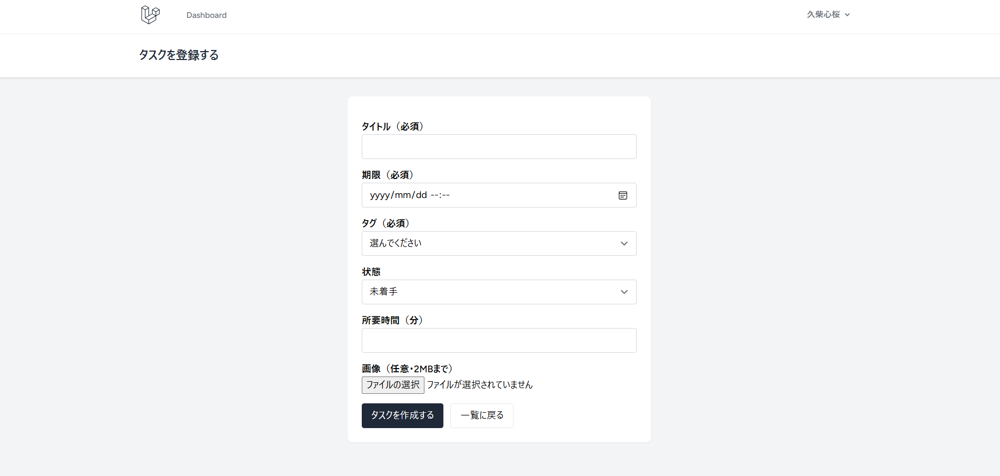
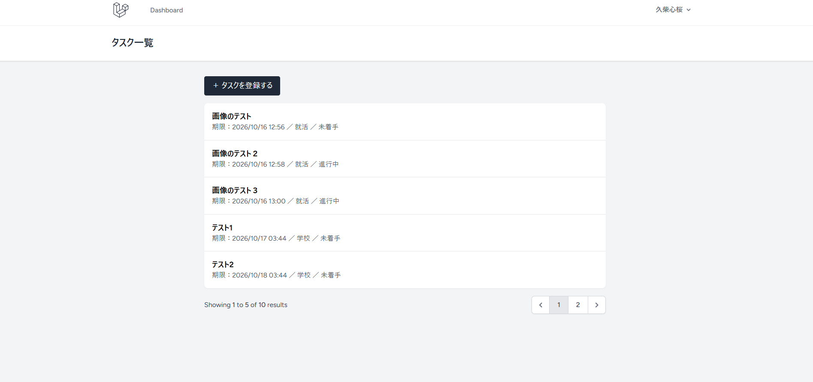
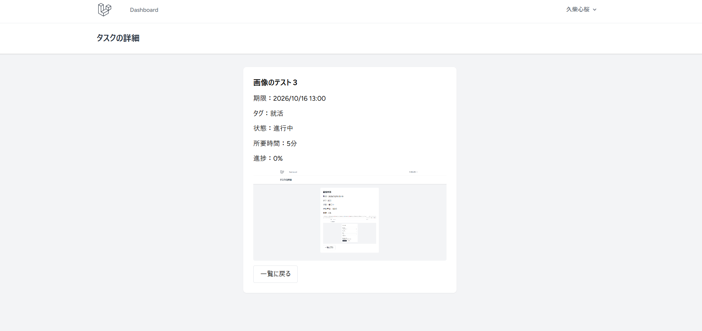

# MyFlow

大学生が、締め切りの重なる就活・課題の優先順位を一目で把握し、迷わなくなるアプリ

## 背景

既存のTodoアプリでは時間を自分で入力する必要があり、入力ミスによって優先度を見誤ってしまうことがある。また、優先順位がひと目でわからないため、結局は課題提出のギリギリまで手をつけられないことが多い。

## ターゲットユーザー

アルバイトを掛け持ちしながら、大学の課題・ゼミ・就職活動を両立させている大学3〜4年生

## MVP機能（Must）

- ①タスクに期限を設定できる
- ②締め切りの近いタスク順に並び替えられる
- ③就活用・学校用で分けて表示できる
- ④タスクを完了にできる
- ⑤タスクを削除できる

## 資料・リンク

| 種類 | リンク |
|---|---|
| 要件定義書 | [docs/requirements.md](docs/requirements.md) |
| DB設計書 | [docs/db-design.md](docs/db-design.md) |
| API仕様書 | [docs/api-spec.md](docs/api-spec.md) |
| 画面設計 | [docs/screen-design.md](docs/screen-design.md) |
| 画面設計（Figma） | [Figmaで見る](https://www.figma.com/design/y40bJxE9KZVL7SDDwE5Jgd/%E7%84%A1%E9%A1%8C?node-id=0-1&t=yTlzt4KPgZPNEbWP-1) |
| スプリント計画 | [docs/sprint-plan.md](docs/sprint-plan.md) |
| カンバン設計 | [docs/kanban-board.md](docs/kanban-board.md) |
| 工数見積もり | [docs/estimate.md](docs/estimate.md) |
| 見積書 | [docs/quotation.md](docs/quotation.md) |
| 技術選定資料 | [docs/tech-stack.md](docs/tech-stack.md) |
| 開発ボード（GitHub Projects） | [MyFlow開発ボード](https://github.com/users/shio-0415/projects/1/views/1) |
| タスク一覧（GitHub Issues） | [Issues](https://github.com/shio-0415/myflow/issues) |

## 開発計画

Week22〜24（10月12日〜30日）の3スプリントで開発する。詳細は[docs/sprint-plan.md](docs/sprint-plan.md)を参照。
## Week22：実装（Laravel）

`src/` に、Laravel（Breeze）で作ったアプリが入っている。

### 実装した機能

- 認証（Laravel Breeze：登録・ログイン・ログアウト）
- タスクの登録・一覧・詳細
- バリデーション（タイトル・期限・タグは必須。画像は2MBまで）
- 画像アップロード
- ページネーション（1ページ5件）

### スクリーンショット

| 登録 | 一覧 | 詳細 |
|---|---|---|
|  |  |  |

### 動かし方

```
cd src
composer install
npm install
cp .env.example .env
php artisan key:generate
touch database/database.sqlite
php artisan migrate --seed
php artisan storage:link
npm run build
php artisan serve
```

### 補足

docs の設計書は、データの保存先を localStorage として書いたもの。Laravel での実装に合わせて見直す予定。
